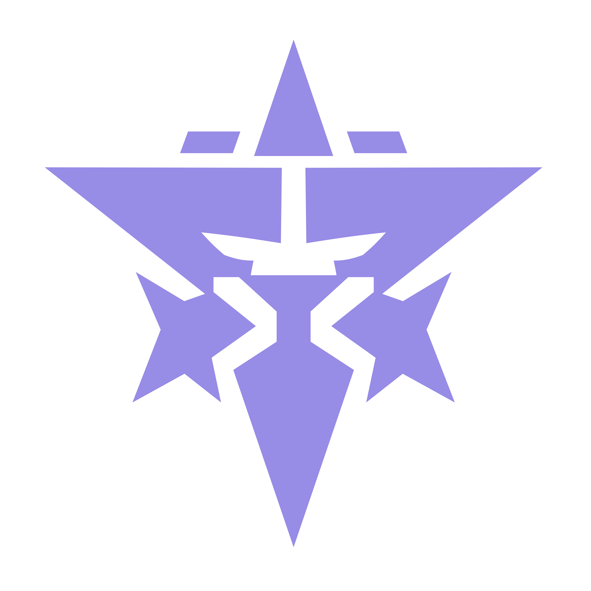
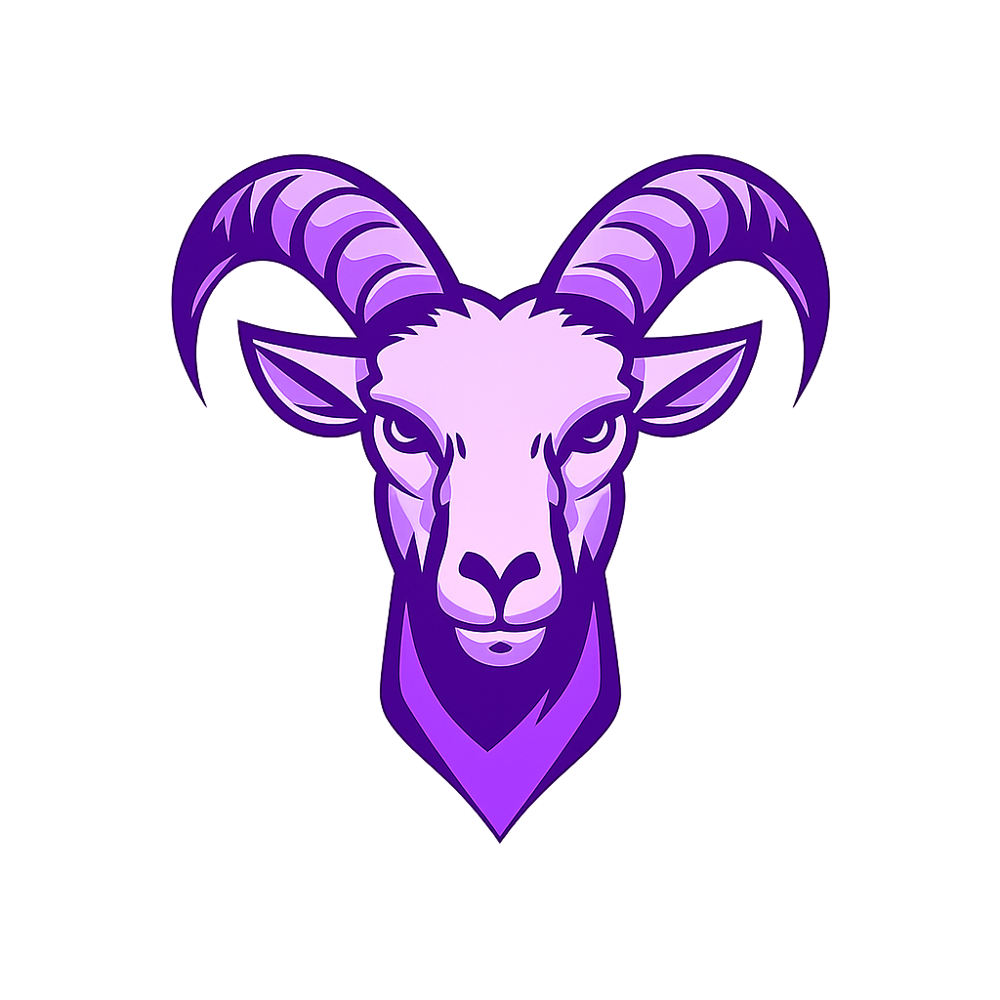
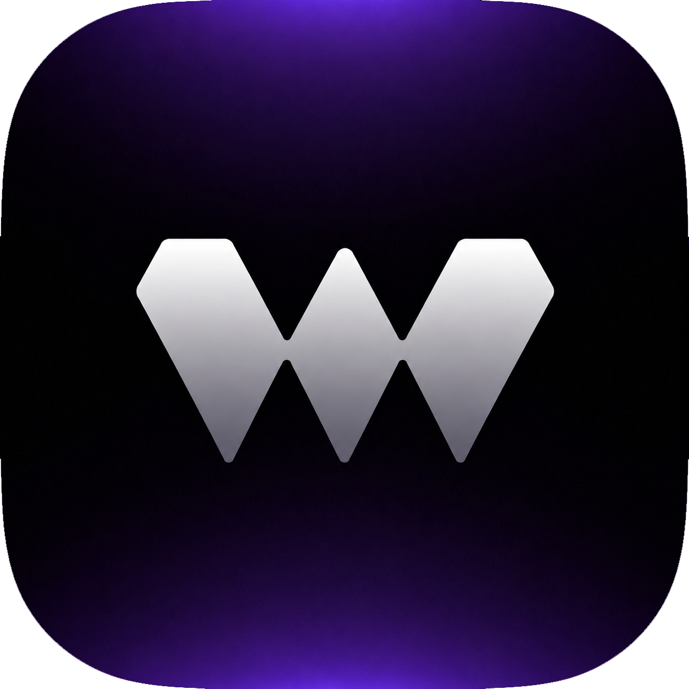
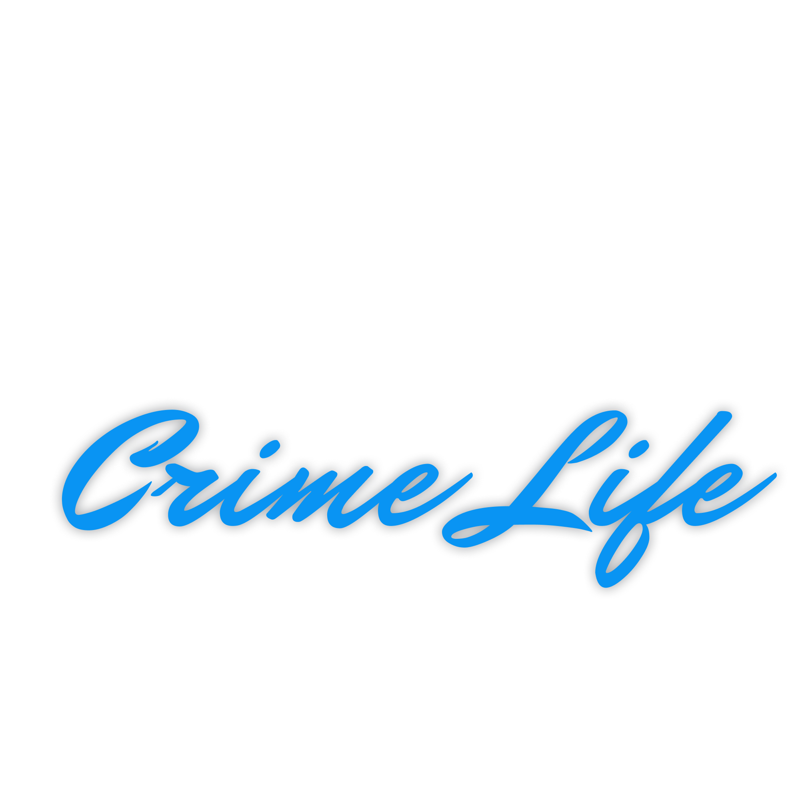

**Frontend · Backend · 3D**

I’m White — I write backend code, handle frontend fixes, and create models.

[Explore my repositories](https://github.com/SeBossWhite?tab=repositories) · [GitHub activity](https://github.com/SeBossWhite?tab=overview)

## A little about me

I’m mainly a backend developer that’s where I focus most of my work. I can write frontend code too, but I mostly handle small fixes and adjustments rather than UI design. I’m also experienced with Blender: creating my own models from scratch, troubleshooting issues, and fixing assets. I know my way around Sollumz for FiveM.

## My toolkit

**Frontend**  
React · Vue · JavaScript · HTML · CSS · Sass

**Backend & scripting**  
Node.js · Python · Lua

**Design**  
Figma · Blender

## Projects & past work

<table>
  <tr>
    <td align="center" width="120"></td>
    <td valign="middle"><strong>Atehra Projekt</strong> Current project.</td>
    <td align="center" width="120"></td>
    <td valign="middle"><strong>GOAT PVP</strong> Previous project.</td>
    <td align="center" width="120"></td>
    <td valign="middle"><strong>Winora Studio®</strong> Previous project.</td>
    <td align="center" width="120"></td>
    <td valign="middle"><strong>Atlas Crimelife</strong> Previous project.</td>
  </tr>
</table>

## Contact

Discord: **`se_boss_white`**

---

<b>SeBossWhite</b> · coding. modeling. creating.

